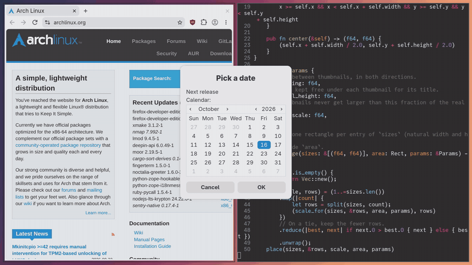
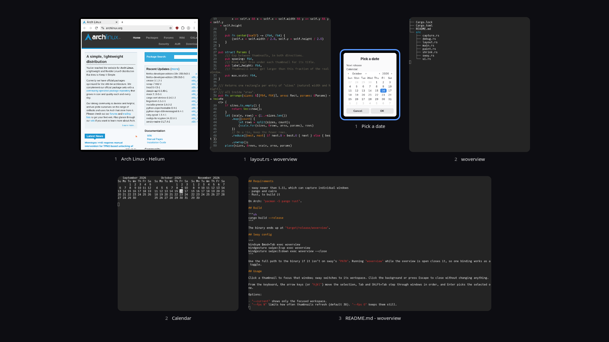

# woverview

A full-screen overview of every open window for sway, in the spirit of Exposé and Mission Control on macOS. Windows zoom out into a grid of live thumbnails, including the ones on other workspaces, in the scratchpad, or hidden behind others. Click one to jump to it.



## Requirements

- sway newer than 1.11, which can capture individual windows
- pango and cairo
- Rust, to build it

On Arch: `pacman -S pango rust`.

## Build

```sh
cargo build --release
```

The binary ends up at `target/release/woverview`.

## Sway config

```
bindsym $mod+Tab exec woverview
bindgesture swipe:3:up exec woverview
bindgesture swipe:3:down exec woverview --close
```

Use the full path to the binary if it isn't on sway's `PATH`. Running `woverview` while the overview is open closes it, so one binding works as a toggle.

## Usage



Click a thumbnail to focus that window; sway switches to its workspace. Click the background or press Escape to close without changing anything.

From the keyboard, the arrow keys (or `hjkl`) move the selection, Tab and Shift+Tab step through windows in order, and Enter picks the selected one.

Options:

- `--current` shows only the focused workspace.
- `--fps N` limits how often thumbnails refresh (default 30). `--fps 0` keeps them still.
- `--close` closes the overview if it's open.
